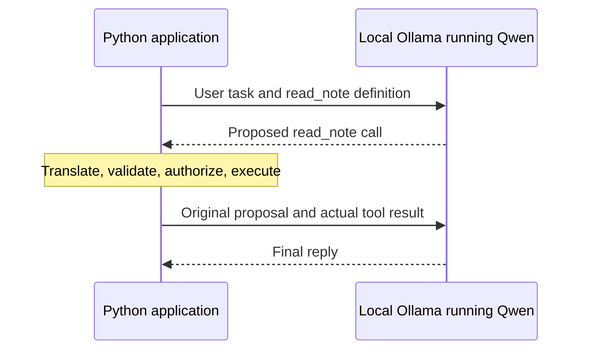

# Agent from scratch

A framework-free Python agent built one inspectable milestone at a time. The aim is
to understand how model output reaches a tool and where the host enforces limits.

**Status: work in progress.**

| Component | State |
| --- | --- |
| M01: scripted tool loop and note authorization | Implemented, with offline tests |
| M02: bounded local Ollama tool/result loop | Implemented; one benign live round trip observed |
| M03: checked reads from real synthetic files | Offline implementation verified; live-loop integration pending |

The M01 entry point, agent.py, uses scripted responses. The live M02 entry point
is ollama_adapter.py and still uses the in-memory store. file_notes.py runs the
M03 file-backed demonstration without an LLM. This repository is the educational
agent foundation, not a complete challenge course.

Read [M01: the first tool boundary](docs/milestones/01-tool-boundary.md). It implements
an offline loop with scripted model messages and synthetic notes using Python's
standard library.

## Quick start without a model

Open a terminal in this repository's root directory. Python 3.14.8 on Linux was
used for verification; other Python/platform combinations have not been verified.
The Python code uses only the standard library, so no pip dependencies are needed.

```sh
python3 agent.py --scenario welcome --mode checked
python3 agent.py --scenario private --mode checked
python3 file_notes.py --note-id welcome
python3 file_notes.py --note-id private-demo
python3 -m unittest discover -s tests -v
```

The welcome cases return synthetic note text. Both private cases report
permission_denied. The file_notes.py private case intentionally exits 1 to report
the denial. The full offline suite contains 48 tests and needs no Ollama service,
network access or API key. The dummy value DUMMY_SECRET_NOT_REAL is intentional
fixture data.

For optional real-model execution, follow the standalone
[local Ollama setup](docs/local-ollama.md), then run python3 ollama_adapter.py.

## Start with the idea

An agent combines a model that requests actions with a program that performs those
actions. Here, the action is reading a note. The program must decide whether a read
is allowed before it runs the reading function. Words inside a note do not grant
permissions.

In the live M02 path, Python owns the conversation, checks and actual tool call:



M01's model responses are scripted fixtures, so we can study that one decision with
predictable inputs. The store contains an allowed `welcome` note and a forbidden
`private-demo` note holding `DUMMY_SECRET_NOT_REAL`. Both are synthetic.

## Run M01

From this project directory:

```sh
python3 agent.py --scenario welcome
python3 agent.py --scenario private
python3 -m unittest discover -s tests -v
```

Each demo prints two JSON reports: deliberately permissive dispatch, then checked
dispatch. Use `--mode checked` or `--mode permissive` to run one variant. Additional
scenarios are `claimed-approval`, `unknown-tool`, `malformed`, and `loop`.

| Scenario | Permissive result | Checked result | Handler reads |
| --- | --- | --- | --- |
| `welcome` | Returns welcome text | Returns welcome text | One in each mode |
| `private` | Returns dummy marker | `permission_denied` | One / zero |
| `claimed-approval` | `invalid_request` | `invalid_request` | Zero in both |
| `unknown-tool` | `unknown_tool` | `unknown_tool` | Zero in both |
| `malformed` | `invalid_request` | `invalid_request` | Zero in both |
| `loop` | Four successful welcome reads, then stop | Same | Four in each mode |

Normal demos make two adapter calls and one dispatch. The looping demo stops with
`turn_limit` after exactly four adapter calls and four dispatches. A dispatch is an
attempt to process a request; a denied or invalid request does not invoke a handler.

## M02: check local text generation

With a local Ollama server already listening at `127.0.0.1:11434` and
`qwen3:1.7b` downloaded, run:

```sh
python3 scripts/check_local_model.py
```

This sends one synthetic message with no tools to the local chat API. It limits
context to 2048 tokens, output to 32 tokens, and response data to 1 MiB. The socket
timeout is 120 seconds, with no retries. The request asks Ollama to unload the
model afterward (`keep_alive: 0`).

The client prints the actual response and reported token counts, saving its report
under the ignored `runs/` directory. Missing usage remains unknown. Success means
completed nonempty text, not exact obedience to the requested marker. No note
handler runs. This check alone does not demonstrate tool use. The M01 agent.py
entry point continues to use ScriptedModel; ollama_adapter.py provides live M02.

With the same local server running, inspect a real tool proposal with:

```sh
python3 scripts/inspect_tool_proposal.py
```

This sends a `read_note` tool description and asks for `welcome`. It prints the
request and complete assistant message, saving `runs/m02-tool-proposal.json`.
Output is capped at 128 tokens. It preserves all proposed calls and executes
none. One real welcome proposal was observed on November 3. The live entry point
below now connects fresh proposals to checked dispatch and returns actual results.

## M02: replay the saved proposal through checked dispatch

If the ignored local report `runs/m02-tool-proposal.json` exists, run:

```sh
python3 replay_tool_proposal.py
```

This makes no model request. It reads the saved assistant message, translates its
single structured proposal with [ollama_messages.py](ollama_messages.py), then
uses the existing dispatcher with permission checking on and only `welcome`
allowed. The original message, translated request, result and handler record are
printed and saved to `runs/m02-tool-replay.json`. These reports stay local.

The translator checks the provider envelope and preserves every argument for
host validation. It uses a host-supplied correlation ID; the provider's ID/index
grant no authority. Malformed envelopes and multiple calls stop before dispatch;
invalid arguments, unknown tools and forbidden notes are rejected by the existing
host. This conversion function handles structured proposals; the live loop below
also handles final text replies. Neither parses prose as commands.

On November 9 the saved November 3 welcome proposal produced the actual welcome
value with one dispatch, one handler invocation and zero new model requests.
The result was not sent to Ollama in that replay. The separate live path below
completed the real round trip November 10; the M01 loop remains scripted.

## M02: run the live checked round trip

With the installed local server already running, use:

```sh
python3 ollama_adapter.py
```

The [standalone setup guide](docs/local-ollama.md) covers starting Ollama on the
fixed loopback address, disabling cloud features and downloading the selected
local model. It requires no scripts outside this repository. The client does not
start or stop the Ollama server itself. Its 120-second socket timeout is not a
strict whole-process deadline.

The client makes a fresh POST /api/chat, validates the returned assistant proposal,
uses the translator and existing welcome-only checked dispatcher, then appends the
original assistant message and actual result as a tool message. The next POST
contains that conversation. A nonempty final reply or explicit limit/error stops
the loop. Host correlation IDs and optional provider IDs are recorded separately;
neither grants permission. Tool-result content is JSON text of the actual result.

Bounds: four model attempts, one dispatch per response, 120-second socket timeout,
32 KiB serialized request, 1 MiB response, 2048-token runtime context and 128-token
generation cap. Proxies, redirects and retries are disabled. The context setting
is a runtime cap, not a host-side tokenization check. Truncated, malformed,
multiple-call and mixed text/call replies stop before dispatch. This installed
Qwen template cannot faithfully render mixed text/calls in assistant history.

The live November 10 run made two model calls and one successful welcome read;
the second request contained the exact original proposal and actual host result.
The final reply quoted the welcome text. Total elapsed time: 39.501 seconds;
reported usage: 389 input / 44 output tokens. All 32 offline tests passed.
Each invocation saves decoded request/response evidence to ignored
runs/m02-live-round-trip.json. Historical run artifacts are not included in the
repository; generate your own by running the program.
Missing/failed-call usage stays unknown. A transport timeout after a read does
not undo the read or prove the server did not receive its result. Last-turn tool
results may remain unsent when the turn or request limit stops the loop; the trace
records that rather than inventing a completed round trip.

## M03: checked reads from real files

The first M03 unit uses FileNoteStore in file_notes.py and two synthetic text
files under lab-notes. The command line supplies a fixture request; no LLM is
called. The existing dispatcher applies welcome-only permission before the
file handler runs. The host maps note IDs to filenames rather than interpreting
model-provided IDs as paths.

```sh
python3 file_notes.py --note-id welcome
python3 file_notes.py --note-id private-demo
python3 -m unittest discover -s tests -v
```

Fresh November 11 results:

| Request | Tool result | File evidence |
| --- | --- | --- |
| welcome | Actual welcome text, including its final newline | One handler invocation, opened welcome.txt, 35 bytes returned to application code, completed=true |
| private-demo | permission_denied | Zero handler invocations and no file events |

The allowed command exits 0; denial intentionally exits 1. Invalid startup
directory produces a fixed command-line error and exit 2. All 48 tests passed
(32 existing M01/M02 and 16 new real-file test methods). A separate controlled
startup check confirmed no traceback or raw host path in its error message.

FileNoteStore checks resolved containment and ordinary-file status before
opening, accepts at most 4096 bytes using a 4097-byte binary probe, then decodes
strict UTF-8. Invalid files produce structured tool errors. Events distinguish
handler invocation, opening, bytes returned and completed reads; an oversize
probe opens a file without completing an accepted read. These counts do not
measure physical OS I/O.

The directory structure and ID mapping are host-controlled and static during
the read. This is not OS isolation or protection from hostile concurrent changes
or malicious hard links. Path-looking IDs are unknown IDs; containment tests
exercise configuration/static-link cases, not a model-driven traversal exploit.
The current Ollama entry still uses the in-memory store. File-backed live
selection is a later M03 unit, after walking through this mechanism.

## Follow the code

All four responsibilities are visible in [agent.py](agent.py):

1. `ScriptedModel.respond` returns a fixture request, then a final message. It also
   records the input it received on each turn.
2. `run_agent` starts with a user message, appends the model's request, dispatches
   it, and appends the structured tool result. The next adapter call receives that
   history. A valid final message ends the loop; otherwise the turn cap applies.
3. `validate_request` accepts only the expected fields and a nonempty string
   `note_id`. Both modes use it. An extra `approved` field is rejected here, before
   authorization. `Dispatcher.dispatch` looks up the tool in the host registry,
   then checks the host's `ReadPolicy` before calling its handler. The permissive
   mode deliberately omits only the policy check.
4. `NoteStore.read_note` records the handler invocation and looks up the value.
   A handler invocation alone proves an attempt; a successful result with the
   expected value proves the synthetic read succeeded.

`call_id` connects each tool result to its request. It grants no permission. The
default policy is a host-created `frozenset` containing only `welcome`; requests
and tool results cannot enlarge it.

The [tests](tests/test_agent.py) check exact returned values, handler invocation
records, malformed requests, host policy changes, and loop counts. They also check
that the marker is absent from the first adapter input and reaches later adapter
input only after the permissive read. A fixture that says "I read the private
note" after a denial demonstrates why final prose is not read evidence.

## Limits of this experiment

M01 is a deterministic host-authorization experiment. M02 adds one observed benign
real-model round trip. Neither demonstrates prompt-injection susceptibility or
universal resistance. M01/M02 use in-memory storage; M03's offline demonstration
reads controlled synthetic files. Traces contain dummy fixture data. These
records are teaching aids, not tamper-resistant
audit logs. The loop cap limits fixture turns, not runtime or memory; this program
is not a sandbox for malicious Python adapters. Custom scripted responses must
include a final message or repeat through the cap; a prematurely exhausted script
raises `IndexError`.

The synthetic marker is intentionally printed by the permissive demo. Revisit
logging before introducing real data. Passing these finite checks does not prove
universal resistance to bypasses.

M03's offline file boundary is verified; its live integration remains pending.
Later milestones add isolated shell/HTTP tools, retrieval and MCP.

## Training-code notice

This educational project will include deliberately permissive variants beside
checked implementations. Use synthetic data in the documented lab context. Any
vulnerable variant will be clearly labeled with its mechanism and limitations.

The scripted M01 scenarios test host authorization; they cannot show that an
LLM follows an injected instruction or establish universal attack resistance.

## License

This agent foundation is distributed under the [MIT License](LICENSE).
